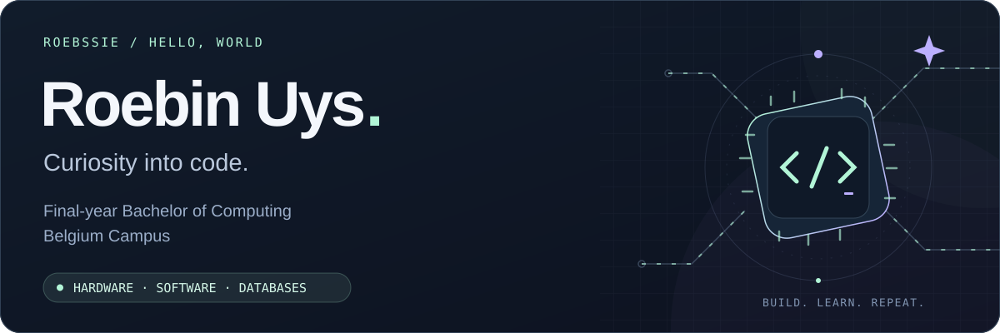
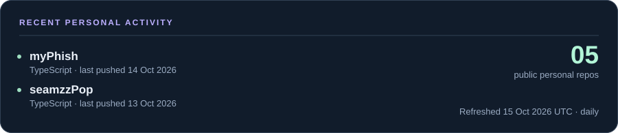

  <picture>
    <source media="(max-width: 600px)" srcset="./assets/hero-mobile.svg" />
    
  </picture>

  <a href="#user-content-about">About</a> &nbsp;·&nbsp;
  <a href="#user-content-skills">Skills</a> &nbsp;·&nbsp;
  <a href="#user-content-personal-projects">Personal projects</a> &nbsp;·&nbsp;
  <a href="#user-content-bc-collaborations">BC collaborations</a> &nbsp;·&nbsp;
  <a href="https://github.com/roebssie?tab=repositories">Explore repositories ↗</a> &nbsp;·&nbsp;
  <a href="https://roebssie.github.io">Explore my digital CV ↗</a>

## About

Hey, I'm **Roebin Uys** — **@roebssie** here. I'm a final-year **Bachelor of Computing** student at **Belgium Campus**, with an interest in the place where hardware meets software.

I enjoy making things with **Arduino** and **Raspberry Pi**, exploring software projects, and working with **databases**. This is my space for sharing experiments, learning in public, and showing the work I've built independently and with others.

**A few things that keep me curious**

- **Hardware that does something useful** — Arduino, Raspberry Pi, and embedded systems.
- **Software that connects the pieces** — applications, practical tools, and automation.
- **Data with a purpose** — databases and the systems built around them.

## Skills · 11 areas

Tools and techniques I'm putting into practice through [RepLab](https://github.com/roebssie/RepLab), my personal iOS gym tracker; [myPhish](https://github.com/roebssie/myPhish), my offline-first aquarium companion; and [seamzzPop](https://github.com/roebssie/seamzzPop), my cross-platform sewing-project app concept.

| Area | Technologies & practical experience |
| :--- | :--- |
| iOS development | **Swift · SwiftUI · UIKit** — native interfaces, animation, haptics, accessibility and persistent light/dark appearance |
| Cross-platform mobile | **TypeScript · React Native · Expo** — shared iOS/Android foundations, reusable components, tab navigation, searchable galleries, modal forms and safe-area layouts |
| Web media tools | **HTML · CSS · JavaScript · MediaRecorder · Canvas 2D · Web Audio API** — responsive browser interfaces, microphone and webcam streams, audio mixing and video overlay composition |
| Data & app state | **SwiftData · AsyncStorage · Foundation · Observation · AppStorage / UserDefaults** — offline-first records, CRUD flows, model relationships, local persistence, saved drafts and preferences |
| Visualisation | **Swift Charts** — workout volume, records and progress trends |
| Apple integrations | **HealthKit · Uniform Type Identifiers** — optional workout export and JSON document export; HealthKit awaits physical-iPhone verification |
| Testing & tooling | **XCTest · Xcode · iOS Simulator · xcodebuild · Expo Doctor** — automated tests, native simulator builds, dependency validation and interaction checks |
| Project automation | **Python · AppKit** — reproducible Xcode project generation and original app-icon tooling |
| Version control & documentation | **Git · GitHub · GitHub Desktop · Markdown · Mermaid** — public source releases, architecture diagrams, setup guides, screenshots and validation notes |
| Android TV customisation | **Java · Android SDK · ADB over Wi‑Fi · Android services · Accessibility APIs · MediaSession · APK packaging/signing · shell diagnostics** — launcher UI, screensavers, remote input, AirPlay background handling and device validation |
| Full-stack web systems | **Node.js · Express · MongoDB · Mongoose · React · Vite · JWT · Jest · Playwright** — layered APIs, role-aware workflows, authentication, civic issue management, browser journeys and local staging |

## Personal projects · 7 projects

My own builds and experiments, collected in one place.

<table>
  <tr>
    <td valign="top">
      <h3><a href="https://github.com/roebssie/RepLab">Featured / RepLab ↗</a></h3>
      
A native iOS gym tracker for routines, sets, reps and weights, with progress charts, local storage and light/dark mode.

      
<code>Swift</code> <code>SwiftUI</code> <code>SwiftData</code> <code>Swift Charts</code>

      
<a href="https://github.com/roebssie/RepLab#preview">See the app ↗</a> · <a href="https://github.com/roebssie/RepLab/tree/main/docs">Read the documentation ↗</a>

    </td>
  </tr>
</table>

<table>
  <tr>
    <td width="50%" valign="top">
      <h3><a href="https://github.com/roebssie/myPhish">02 / myPhish ↗</a></h3>
      
An offline-first aquarium companion for tracking freshwater tanks, individual fish and groups, care history, sizes, notes and aquarium transfers.

      
<code>TypeScript</code> <code>React Native</code> <code>Expo</code> <code>AsyncStorage</code>

      
<b>Practised:</b> mobile information architecture, reusable UI components, local CRUD data, search and form flows, native iOS validation, app branding and screenshot-led documentation.

      
<a href="https://github.com/roebssie/myPhish#screenshots">See the app ↗</a>

    </td>

    <td width="50%" valign="top">
      <h3><a href="https://github.com/roebssie/seamzzPop">03 / seamzzPop ↗</a></h3>
      
A cross-platform mobile foundation for garment inspiration, rights-aware pattern discovery and future parametric sewing workflows.

      
<code>TypeScript</code> <code>React Native</code> <code>Expo</code>

    </td>
  </tr>
  <tr>
    <td width="50%" valign="top">
      <h3><a href="https://github.com/roebssie/Box_Flasher">04 / Box Flasher ↗</a></h3>
      
Embedded-device tooling for the Amlogic S905W, including a system monitoring service, cross-compilation, and device setup scripts.

      
<code>C++</code> <code>Shell</code> <code>CMake</code> <code>Linux</code>

    </td>
    <td width="50%" valign="top">
      <h3><a href="https://github.com/roebssie/calculator">05 / Calculator ↗</a></h3>
      
A browser-based calculator project: a small space to explore application logic and web interfaces.

      
<code>HTML</code> <code>CSS</code> <code>JavaScript</code>

    </td>
  </tr>
</table>

<table>
  <tr>
    <td valign="top">
      <h3><a href="https://github.com/roebssie/debloat-android-xiaomi-mi-tv-box">06 / Debloat Mi Box S · Roebssie’s TV OS ↗</a></h3>
      
A minimal custom TV experience for a Xiaomi Mi Box S: a clean Apple TV-inspired launcher, custom screensaver, media banners, quiet AirPlay handling and Android debloating.

      
<code>Java</code> <code>Android SDK</code> <code>ADB</code> <code>Accessibility APIs</code> <code>MediaSession</code>

      
<b>Practised:</b> Android TV launcher development, ADB over Wi‑Fi, accessibility-driven window handling, background services, remote navigation, media artwork, screensaver rendering, APK packaging and device testing.

      
<a href="https://github.com/roebssie/debloat-android-xiaomi-mi-tv-box#readme">Read the project ↗</a>

    </td>
  </tr>
</table>

### BC student build · personal project

<table>
  <tr>
    <td valign="top">
      <h3><a href="https://github.com/roebssie/bc-assignment-recording-app">BC Assignment Recording App ↗</a></h3>
      
An independent browser recorder for BC assignment demos. Add narration and an optional webcam bubble to a video, then download a polished walkthrough other students can use.

      
<code>HTML</code> <code>CSS</code> <code>JavaScript</code> <code>MediaRecorder</code> <code>Canvas 2D</code> <code>Web Audio API</code>

      
<a href="https://roebssie.github.io/bc-assignment-recording-app/">Try the app ↗</a> · <a href="https://github.com/roebssie/bc-assignment-recording-app">Source and setup ↗</a>

      
<b>Classification:</b> A personal student build with a Belgium Campus connection; it is not an official BC product.

    </td>
  </tr>
</table>

**Current focus:** Building mobile products that combine thoughtful interfaces, practical offline data flows and transparent AI-assisted features across iOS and Android.

## BC collaborations

Coursework and group builds from **Belgium Campus**. These projects were developed with other students; each link leads to the team's original repository.

| Area | Team project | Course |
| :--- | :--- | :--- |
| Web applications | [Ticket booking webpage ↗](https://github.com/AdolfJonker/WPR381_Ticket_Booking_webpage) | WPR381 |
| Web applications | [Community portal ↗](https://github.com/volkrum123/WPR381-Community-portal) | WPR381 |
| Java applications | [Cleaning inventory system ↗](https://github.com/mqadi11/CleaningInventorySystem) | PRG381 |
| VR / sign-language learning | [PRJ381 · BCSignVR SignVR app · Mac working version ↗](https://github.com/Kollekiess/PRJ381-PTA--BCOM-Group-2/tree/roebin-working-version-mac) | PRJ381 · with Carl |
| Software engineering | [SEN381 · Civic Connect · sanitized portfolio copy ↗](https://github.com/roebssie/civic-connect-sen381) | SEN381 · with Carl · [original profile ↗](https://github.com/CarlEls30) |
| Databases | [MongoDB replica set ↗](https://github.com/TropicSatern36/MongoDB-Replica-set-Uni-2025) | University project |

  
<b>More BC group work</b>

   

  | Team project | Course | Contribution highlights |
  | :--- | :--- | :--- |
  | [Group programming project ↗](https://github.com/Bianca333-b/PRG282_Group_Project) | PRG282 | Added setup guidance for the Superhero Database System and contributed minor changes and tests. |
  | [Programming project ↗](https://github.com/TobesOfCode/Project-LPR381) | LPR381 | Team coursework project. |

## From the workbench

A daily snapshot of public activity in my personal repositories. The contribution calendar below shows my broader GitHub activity.

  <a href="https://github.com/roebssie?tab=repositories">
    <picture>
      <source media="(max-width: 600px)" srcset="./assets/activity-mobile.svg" />
      
    </picture>
  </a>

---

  <b>Curious about hardware. Serious about learning. Always building.</b> 
  Roebin Uys &nbsp; / &nbsp; @roebssie &nbsp; / &nbsp; Belgium Campus

